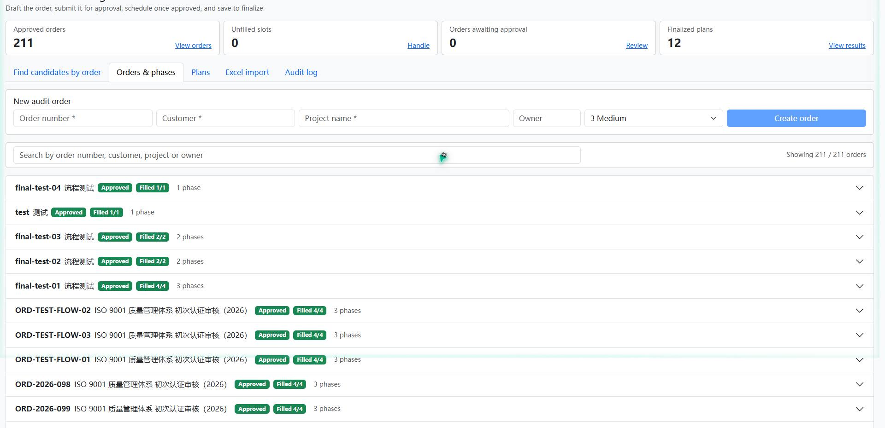
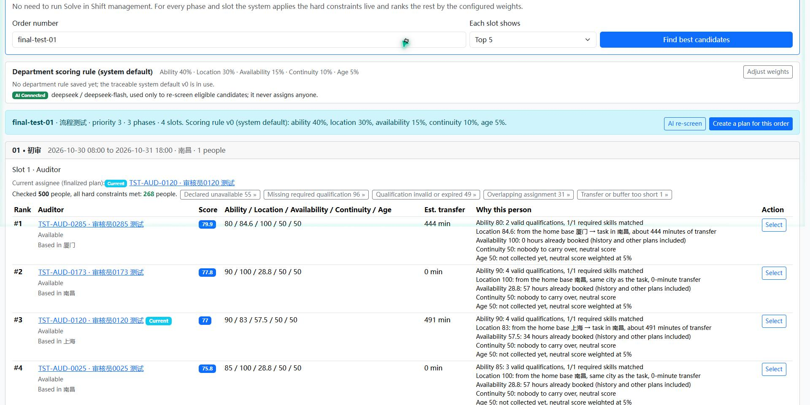
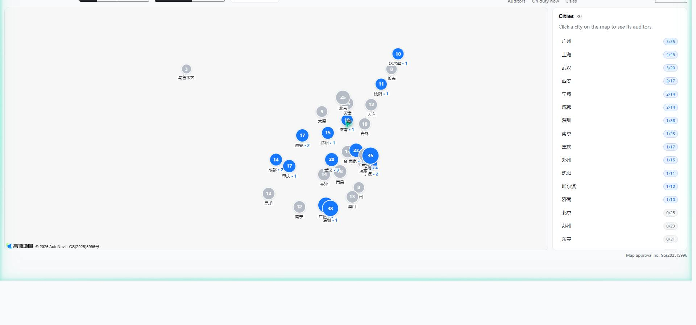
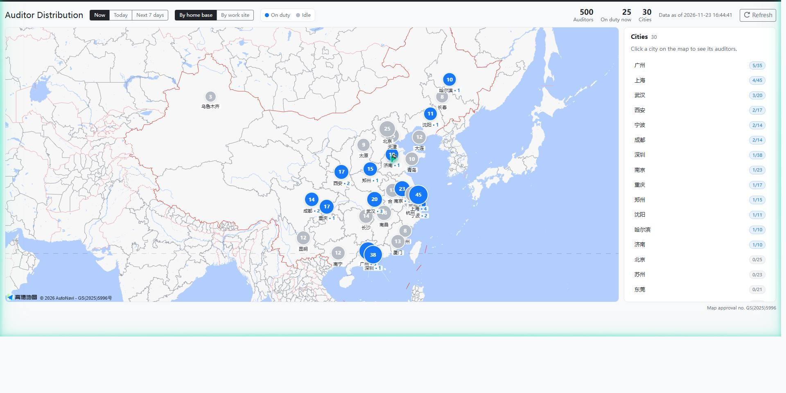

<div align="center">

# 审核员调配系统

**按订单挑人、按规则筛人、按分数排序的审核排班工作台**


</div>

---

## 这是什么

认证机构（审核/认证行业）在排期时同时要满足四件事：**项目周期、每个阶段的人数和资格、审核员的可用时间与所在地、以及不能撞车**。这些信息过去散在表格和邮件里，每排一次就要重新确认一遍，冲突往往排完才发现。

这个系统把这条链路收进一个工作台：**建订单 → 配阶段 → 提交审批 → 批准后查候选 → 锁定人员 → 定稿生效**，候选名单由硬约束先筛、五项权重再排序，并给出「为什么选他」的逐条理由。

> **English abstract**
> An auditor scheduling workbench for certification bodies. Orders carry phases (document review / on-site audit / corrective-action follow-up); once an order is approved, the system filters every auditor by hard constraints — qualification validity, lead-auditor grade, declared unavailability, shift overlap, transfer time and a 48-hour return-to-base window — then ranks the survivors with five weighted scores (ability 40%, location 30%, availability 15%, continuity 10%, age 5%) and explains each ranking. Built with Quarkus + React + SQLite/PostgreSQL, bilingual UI (Chinese / English).

## 界面

| 工作台 · 订单与阶段 | 候选名单（含评分理由） |
|---|---|
|  |  |

| 排班时间轴 | 审核员分布地图 |
|---|---|
|  |  |

## 功能

| 模块 | 能力 |
|---|---|
| **订单与审批** | 订单含客户、项目、优先级、多个阶段；提交审批前有门禁（必须有阶段、人数 ≥ 1、就绪阶段必须配资格）；只有 `APPROVED` 的订单才能排班 |
| **候选筛选** | 硬约束：资格有效性 / 主审等级 / 登记不可用 / 时间重叠 / 转场缓冲 / 48 小时返程空窗；被排除的人可按原因下钻查看名单 |
| **评分排序** | 五项加权（能力 40、位置 30、空闲度 15、连续性 10、年龄 5），权重可按部门版本化调整；每条理由给出数字与分支（同城 / 跨城 / 坐标缺失 / 超基准） |
| **方案（Plan）** | 按订单生成草案 → 逐个名额锁定 → 定稿写回班次；支持快照、修订、紧急换人；定稿前自动安全备份，之后只读 |
| **排班管理** | 按审核员 / 按地点两种视图，周 / 月粒度（配置页切换）；按地点周视图是「每天一格」的方块表；行搜索、右键菜单、缺口与风险高亮 |
| **地图** | 中国地图上按城市打点，可切换「按常驻 / 按现场」两种口径；在岗判定直接看班次，不看方案状态 |
| **双语** | 界面中 / 英一键切换（导航栏右侧），含后端生成的评分理由；用户数据（姓名、城市、项目名）不翻译 |
| **其他** | Excel 导入（预检查 + 错误清单）、操作审计日志、PDF 报表、邮件模板、数据库备份与恢复、多部门（structure）隔离 |

## 技术栈

- **后端**：Quarkus 3.37 · Java 17+（开发用 JDK 21）· Hibernate ORM · Flyway · SQLite（默认）/ PostgreSQL
- **前端**：React 19 · TypeScript 5.9 · Vite 8 · react-bootstrap · vis-timeline 8 · 高德地图 JS API
- **求解器**（可选）：Timefold Solver 1.33 —— 主路径是「按订单挑人」，求解器用于整窗排班

## 快速开始

### 环境

| 依赖 | 版本 | 说明 |
|---|---|---|
| JDK | 17 及以上（推荐 21） | `pom.xml` 的 `maven.compiler.release=17` |
| Maven | 3.9+ | 或使用 IDE 内置 |
| Node.js | 22（仅改前端时需要） | 只运行后端不需要 Node |

### 后端

```bash
# 1) 打包（第一次会下载依赖）
mvn package -DskipTests -Dquarkus.profile=sqlite

# 2) 设置会话密钥（必须，否则拒绝启动：默认值公开在仓库里，等于谁都能伪造 ADMIN 会话）
export AUTH_SESSION_KEY="$(head -c 36 /dev/urandom | base64)"   # Windows: 随便 32 位以上的随机串

# 3) 运行
java -Dquarkus.profile=sqlite -Dquarkus.http.port=8081 \
     -jar target/quarkus-app/quarkus-run.jar
```

打开 <http://localhost:8081>。首次启动会用 Flyway 自动建库建表到 `databases/employee_scheduling.db`，
随后写入一份示例数据（见下文「数据」）。

**没有预置账号**：第一个注册的人自动成为 `ADMIN`（本地 sqlite 走 `standalone` 注册模式，不需要邮箱验证）；之后由管理员在「用户」页创建其他人。

### 前端（只有改界面时才需要）

```bash
cd frontend
npm ci
npm run dev            # 开发服务器，代理到 8081

# 生产构建：产物同步进后端静态资源目录后再打 jar
npm run build
python ../.sync_build.py
```

仓库里已经带了构建好的前端产物（`src/main/resources/META-INF/resources/assets`），所以只跑后端也能直接看界面。

### 跑测试

```bash
mvn test -Dquarkus.test.profile=test-sqlite
```

测试库是独立的 SQLite 文件，不会碰你的工作库。

## 配置

所有配置都有安全默认值，**没有任何内置密钥**。生产环境请通过环境变量注入：

| 环境变量 | 作用 | 默认 |
|---|---|---|
| `DISPATCH_AI_ENABLED` | 是否启用 AI 初筛（对规则筛出的候选做二次复核） | `false` |
| `DISPATCH_AI_PROVIDER` / `DISPATCH_AI_MODEL` | 模型服务商与模型名 | — |
| `DISPATCH_AI_API_KEY` | 模型 API Key | 空 |
| `DISPATCH_AI_BASE_URL` | API 地址（兼容 OpenAI 协议） | — |
| `AMAP_JS_KEY` / `AMAP_JS_SECURITY_CODE` | 高德地图 JS API 的 Key 与安全密钥（不配则地图页给出配置提示，其余功能不受影响） | 空 |
| `AMAP_API_KEY` | 高德 Web 服务 Key，用于计算城市间驾车时长（不配则退化为直线距离估算） | 空 |
| `AUTH_SESSION_KEY` | 会话加密密钥，至少 32 个随机字符。**`java -jar` 必须自己提供**（安装脚本会自动生成） | — |
| `APP_REGISTRATION_MODE` | `auto` / `standalone` / `server` | `auto` |
| `APP_DEMO_DATA` | 是否写入示例数据（只在空库首次启动时写） | `true` |
| `DISPATCH_RETURN_TO_BASE_HOURS` | 返程空窗期小时数 | `48` |
| `DISPATCH_LOCATION_SCORE_BASELINE_MINUTES` | 位置分归零的转场基准（分钟） | `2880` |

> **不要把 `.env` 提交进仓库。** 它已在 `.gitignore` 里；仓库只保留 `.env.example` 作为模板。

## 数据

- 数据库文件：`databases/employee_scheduling.db`（已加入 `.gitignore`，不入库）
- 建表：Flyway，迁移脚本在 `src/main/resources/db/migration/{sqlite,postgresql}`，两套引擎的 DDL 由测试强制对齐
- 示例数据：**空库第一次启动时会自动写入**（可用 `APP_DEMO_DATA=false` 关掉），内容是
  一个「演示部门」+ 6 项资格 + 4 个城市 + 8 名审核员 + 4 张订单（草稿 / 待审批 / 已批准两份，
  共 11 个阶段 15 个名额，其中 4 个已派人，北京那段现场审核跨过当天，所以地图上能看到在岗）。
  只要库里已经有任何部门，它就静默跳过——不会混进真实数据。
- 备份：应用内的备份页会把快照写到 `databases/backups/`（同样不入库）

## 目录结构

```
├── src/main/java/org/acme/employeescheduling/
│   ├── rest/          REST 端点（订单、方案、排班、地图、导入、备份…）
│   ├── persistence/   实体与仓储
│   ├── service/       业务服务（风险判定、审计、翻译同步…）
│   └── dto/           请求/响应模型
├── src/main/resources/
│   ├── db/migration/  Flyway 迁移（sqlite + postgresql 双份）
│   ├── i18n/          界面文案（TSV，7 字段 5 语言）
│   └── META-INF/resources/  构建好的前端产物
├── frontend/src/
│   ├── pages/         工作台、排班、地图、报表、配置…
│   ├── components/    时间轴、天格子、表单、弹窗…
│   ├── i18n/          i18next 初始化、内置中文包、英文兜底词典
│   └── api/           后端接口封装
├── docs/              架构、认证、配置、安装、用户手册
└── databases/         运行时数据库（.gitignore）
```

## 几个关键设计

**「分配即生效」，没有单独的发布动作。** 班次行一旦写入 `employee_id` 就算派工，地图在岗、负荷分、冲突检查都直接读这张表。方案（Plan）是**可选的复查容器**，定稿只是批量把锁定的人写进班次，不是生效闸门。

**硬约束只有一份实现。** 候选筛选、定稿校验、订单页的风险标红，全部走同一个 `AssignmentRiskService`，判定顺序固定为：资格有效期 → 主审等级 → 登记不可用 → 时间重叠 → 后向转场缓冲 → 前向 48 小时空窗。避免“候选说可以、定稿说不行”。

**48 小时返程空窗期。** 上一个任务结束后 48 小时内，认为人还在任务所在地，转场从那里算；超过 48 小时按常驻地算。**打分和硬约束共用同一套出发地判定**，不会出现两处口径不一致。

**位置分有基准，不是非黑即白。** 公式是 `100 − min(基准, 转场分钟) × 100 / 基准`，基准默认 48 小时（可配）。早期写死 4 小时导致跨城一律 0 分，30% 的位置权重退化成“同城/不同城”二值。

**方案只在「写了同一个班次」时才互为版本。** 不同订单在同一时间段各干各的活是常态，时间窗重叠不算覆盖；只有真正共享班次的方案，后定稿的才把前一个标记为 `SUPERSEDED`。定稿弹窗的影响预览和实际执行共用同一个判定方法。

**地图两种口径必须分开。** 圈里的数字在「按常驻」下是常驻人数（看人力储备），在「按现场」下是此刻在该城干活的人数（看现场兵力）。同一个数字两种含义，不做切换就会读错。

## 已知限制

- **年龄分恒为 50**：员工表还没采集出生日期，这一项实际不参与区分（只占 5%）
- **能力分区分度有限**：命中 1 条必需资格 + 持有 4 条以上 + 主任级即封顶 100，多数候选同分；权重可按部门调，但公式本身偏宽
- **转场时长按驾车估算**：长途会显著高估（如深圳→乌鲁木齐约 46 小时，实际飞行 5.5 小时），远距离跨城在 48 小时窗口内几乎排不进去；转场矩阵有 24 小时 TTL，边界上的分配可能随路况翻转
- **AI 初筛需要自备 Key**，未配置时只做规则匹配，功能完整可用

## 许可证与致谢

Apache License 2.0，见 [LICENSE](LICENSE) 与 [NOTICE](NOTICE)。

本项目衍生自 [Timefold Quickstarts](https://github.com/TimefoldAI/timefold-quickstarts) 的 `employee-scheduling` 示例（Apache 2.0），并做了大量改造：React/TypeScript 前端、审核订单与阶段审批流、按订单的候选筛选与加权排序、审核员地图与排班时间轴、双语界面、审计日志与备份体系等。
